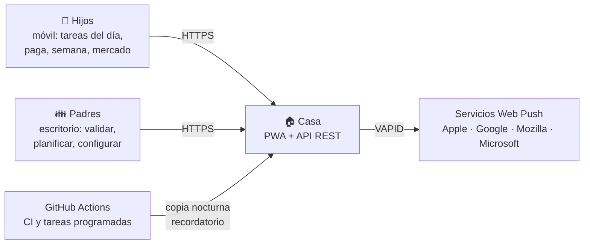
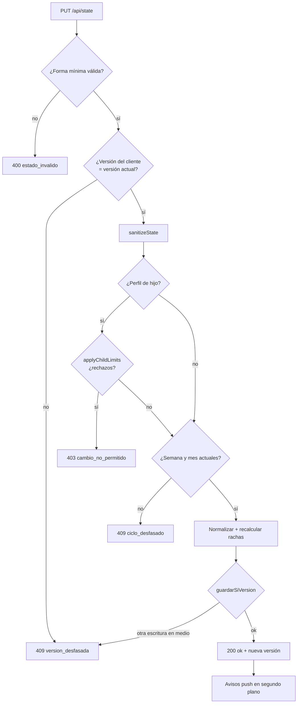
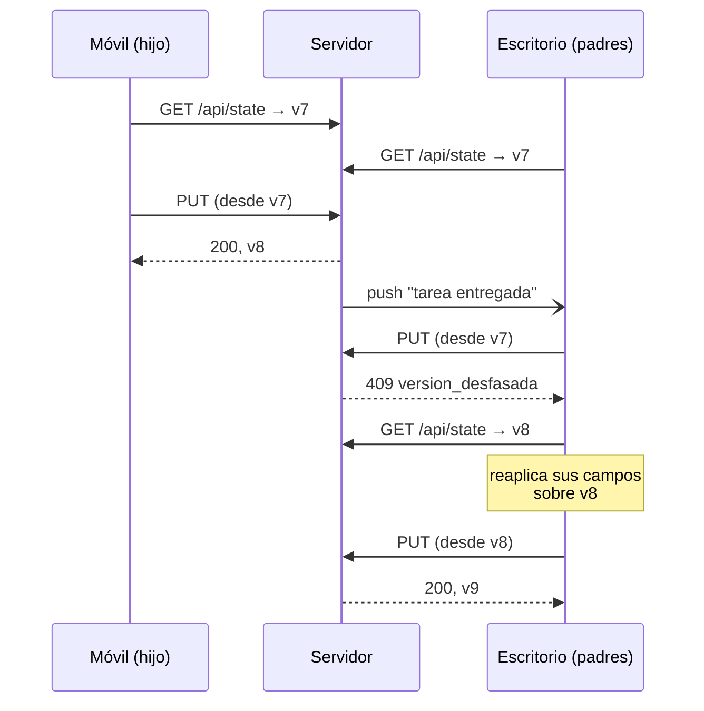
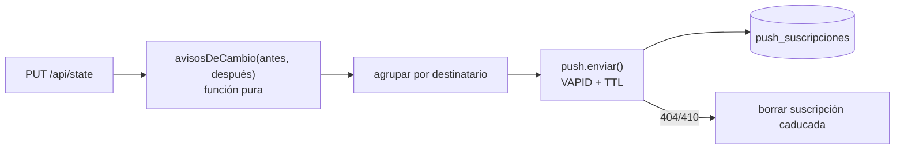

# Arquitectura

Visión técnica del sistema: componentes, responsabilidades, flujo de una petición, sincronización
entre dispositivos y los invariantes que no se pueden romper.

- [Contexto](#contexto)
- [Componentes](#componentes)
- [Capas del servidor](#capas-del-servidor)
- [Ciclo de vida de una petición](#ciclo-de-vida-de-una-petición)
- [Sincronización entre dispositivos](#sincronización-entre-dispositivos)
- [El paso del tiempo](#el-paso-del-tiempo)
- [Avisos push](#avisos-push)
- [Copias de seguridad](#copias-de-seguridad)
- [Cliente](#cliente)
- [Invariantes](#invariantes)
- [Atributos de calidad](#atributos-de-calidad)

---

## Contexto

Una instalación sirve a **una sola casa**: tres perfiles de hijo y un panel de padres, entre
cuatro y seis dispositivos y unos pocos kilobytes de datos. Esa escala condiciona todo el diseño:
se prioriza la simplicidad, la recuperabilidad y el coste cero de infraestructura frente a la
escalabilidad horizontal.



## Componentes

| Componente | Tecnología | Responsabilidad |
|---|---|---|
| **PWA** | HTML + CSS + JS sin framework (`public/index.html`) | Interfaz móvil de los hijos y escritorio de los padres; sondeo y fusión de conflictos |
| **Service worker** | `public/sw.js` | Caché del "cascarón" de la app (nunca de la API) y recepción de avisos |
| **Perfiles** | `public/perfiles.js` (UMD) | Fuente única de los perfiles; la cargan el navegador (`<script>`) y el servidor (`require`) |
| **API** | Express 5 (`server.js`, `routes/`) | Validación, autorización, persistencia y orquestación |
| **Dominio** | `services/` | Reglas de negocio como funciones puras: saneado, ciclos, rachas, puntos, avisos |
| **Persistencia** | PostgreSQL 16 | Documento de estado versionado, copias, suscripciones push, metadatos |
| **Automatización** | GitHub Actions | CI, copia nocturna fuera del servidor y disparo del recordatorio diario |
| **Demo** | `public/demo.js` | Sustituye la capa de red por un servidor simulado en memoria |

## Capas del servidor

```
routes/        HTTP: parseo, códigos de estado, permisos por ruta
   │
services/      Dominio puro (sin E/S)          Acceso a datos
   ├── stateGuard.js   saneado y límites       ├── estadoService.js  leer / guardar con versión
   ├── ciclos.js       semana, mes, vencidas   ├── copias.js         casa_copias
   ├── rachas.js       rachas                  └── push.js           suscripciones y envío
   ├── puntos.js       resumen del mes
   ├── avisos.js       qué avisar y a quién
   ├── tiempo.js       fechas en la zona de la casa
   └── codigoCasa.js   acceso y límite de intentos
   │
db/            Pool de pg y migraciones idempotentes
```

La regla es que **la lógica de negocio no hace E/S**: recibe un estado y devuelve otro (o una
lista de avisos). Eso permite cubrirla con 147 pruebas que se ejecutan en segundos sin base de
datos ni red.

## Ciclo de vida de una petición

### Middleware común (`server.js`)

1. Cabeceras de seguridad: `X-Content-Type-Options`, `X-Frame-Options: DENY`,
   `Referrer-Policy: no-referrer`, `X-Robots-Tag: noindex`, `Strict-Transport-Security`.
2. `express.json({ limit: "4mb" })`.
3. Estáticos desde `public/`.
4. `/api/health` (público).
5. **Guardia del código de casa** para el resto de `/api` (si `CODIGO_CASA` está definido).
6. Rutas → 404 JSON para `/api` desconocidas → manejador final (4xx del cliente se devuelven tal
   cual; el resto, 500 sin filtrar detalles).

### Lectura: `GET /api/state`

`leerEstadoAlDia()` (`services/ciclos.js`) es la única forma de leer el estado:

1. Lee la fila y su versión.
2. Guarda la **copia diaria** si hoy aún no existe (antes de mutar nada).
3. Traduce perfiles antiguos si los hubiera (`adoptarPerfiles`).
4. Aplica el **cambio de semana o de mes** si el reloj del servidor lo indica.
5. Completa la forma del estado (casillas, menús, calendario) y recalcula rachas.
6. Si algo cambió —comparando con `huella()`, no con `JSON.stringify`—, **lo persiste**.

### Escritura: `PUT /api/state`



El orden es deliberado: la comprobación de versión va **antes** que las reglas de perfil para que
un dispositivo desfasado reciba un `409` reintentable y no un `403` que haría perder su cambio.
Los avisos se envían **después** de responder, para que un servicio de push lento no penalice a
quien guarda.

## Sincronización entre dispositivos



- Cada cliente sondea cada **4 segundos** y repinta sin parpadeo si hay una versión nueva.
- La escritura es **condicional** (`UPDATE … WHERE version = $n`), atómica en PostgreSQL.
- Ante un `409`, el cliente vuelve a aplicar los campos de primer nivel que él cambió sobre el
  estado fresco. La granularidad de la fusión es el campo de primer nivel (ver
  [ADR-0002](adr/0002-concurrencia-optimista.md)).
- El estado propio de cada dispositivo (perfil activo, pestaña, código de casa) vive en
  `localStorage`, nunca en el documento compartido.

## El paso del tiempo

Todo lo que depende de la fecha lo decide **el reloj del servidor** en la zona `TZ_FAMILIA`
(`services/tiempo.js`); un dispositivo con la fecha mal configurada no puede adelantar ni atrasar
un ciclo ([ADR-0005](adr/0005-reloj-del-servidor.md)).

| Ciclo | Disparador | Efecto |
|---|---|---|
| Día | primera lectura del día | copia diaria |
| Semana | lunes (`claveSemana`) | se vacían las casillas de las fijas; la racha se arrastra si el domingo estaba completo |
| Mes | día 1 (`claveMes`) | lo no entregado pasa a *vencida*, se archiva el resumen en `history`, se vacían reparto y mercado; calendario y horarios se conservan |
| Tarde | GitHub Actions, 17:00–21:30 | recordatorio, como máximo una vez al día |
| Noche | GitHub Actions, 03:30 | copia del estado en la rama `copias` (opcional, solo en repositorios privados) |

Los ciclos se aplican de forma **perezosa** en la primera lectura posterior, así que el servidor
puede estar suspendido sin perder ninguno.

## Avisos push



- `avisosDeCambio` compara el estado anterior y el nuevo y produce eventos dirigidos: entrega →
  padres; aprobación o devolución → hijo; premio pedido → padres; petición en el mercado →
  vendedor. **Nunca** avisa a quien hizo el cambio.
- `recordatoriosDelDia` genera el recordatorio de la tarde: a cada hijo, lo planificado para hoy
  sin hacer y las diarias sin marcar; a los padres, lo pendiente de validar.
- El envío es idempotente por día mediante un `INSERT … ON CONFLICT … WHERE` atómico sobre
  `casa_meta`.
- Solo se aceptan suscripciones cuyo `endpoint` pertenece a un servicio de push conocido, de modo
  que el servidor no puede usarse para hacer peticiones a direcciones arbitrarias (SSRF).

## Copias de seguridad

| Capa | Momento | Retención | Ubicación |
|---|---|---|---|
| Diaria | primera lectura del día | 30 | `casa_copias` |
| Preventiva | antes de `reset`, `restore` o restaurar copia | 10 | `casa_copias` |
| Externa (opcional) | cada noche | una por día | rama `copias` de un repositorio privado |

Toda operación destructiva guarda antes una copia, de modo que **cualquier acción se puede
deshacer con otra**. Ver [ADR-0009](adr/0009-copias-en-tres-capas.md).

## Cliente

- Un único `index.html` con CSS por *tokens* y JavaScript estructurado por secciones (motor,
  vistas de escritorio, vistas móviles, sincronización).
- Escapado sistemático (`esc`, `escColor`) de todo dato del estado antes de pintarlo.
- `localStorage` solo para preferencias del dispositivo.
- El service worker nunca cachea `/api`: los datos siempre son frescos o explícitamente
  inaccesibles.
- En `/demo`, `demo.js` intercepta `fetch` y responde desde un estado en memoria.

## Invariantes

Reglas que, si se rompen, producen errores ya vividos en producción:

1. **Normalizar solo en el servidor y persistirlo.** Si el cliente corrige la forma del estado en
   memoria sin guardarla, cada sondeo detecta una diferencia y la pantalla entra en un bucle de
   repintado. El cliente lee con valores por defecto (`S.agenda || []`) y nunca escribe al leer
   ([ADR-0004](adr/0004-normalizacion-en-el-servidor.md)).
2. **Comparar con `huella()`.** PostgreSQL (`jsonb`) reordena las claves; `JSON.stringify`
   devolvería "distinto" para dos objetos iguales.
3. **Cada campo nuevo del estado se sanea.** `sanitizeState` es una lista blanca: lo que no
   sanea, se descarta al guardar.
4. **Ninguna decisión temporal en el cliente.**
5. **Los ids de perfil son estables.** Están referenciados en todo el documento; cambiarlos
   equivale a borrar el historial de esa persona.

## Atributos de calidad

| Atributo | Cómo se aborda |
|---|---|
| Integridad | Concurrencia optimista, saneado por lista blanca, límites por perfil en el servidor |
| Recuperabilidad | Copias en tres capas y operaciones destructivas reversibles |
| Mantenibilidad | Dominio puro y probado; cuatro dependencias; ADR para cada decisión relevante |
| Coste | 0 €/mes: Render y Neon en plan gratuito, GitHub Actions como planificador |
| Disponibilidad | Arranque en frío de Render (~30 s) aceptado; ciclos perezosos tolerantes a la suspensión |
| Accesibilidad | WCAG AA en contraste, foco visible, movimiento reducido |
| Portabilidad | PWA instalable en iOS y Android; TWA lista para Google Play |
