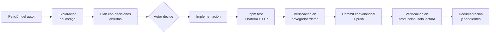

# Desarrollo con IA

Este proyecto se ha construido con **Claude Code** (Anthropic) como agente de programación. Este
documento explica cómo se repartió el trabajo, qué proceso se siguió y qué se aprendió.

- [Reparto de responsabilidades](#reparto-de-responsabilidades)
- [Proceso de trabajo](#proceso-de-trabajo)
- [Evolución del proyecto](#evolución-del-proyecto)
- [Garantías de calidad](#garantías-de-calidad)
- [Errores que encontró el proceso](#errores-que-encontró-el-proceso)
- [Lecciones](#lecciones)
- [Cifras](#cifras)

---

## Reparto de responsabilidades

| Persona (autor) | Agente de IA |
|---|---|
| Visión de producto y prioridades | Diseño técnico y propuesta de alternativas |
| Decisiones con impacto en el uso (p. ej. perfiles sin contraseña, calendario por franjas) | Implementación en servidor, cliente y base de datos |
| Validación de cada entrega y del uso real en casa | Pruebas automáticas y verificación en el navegador |
| Aprobación de commits, despliegues y cambios de configuración | Auditorías del estado del proyecto con puntuación razonada |
| Contexto del hogar: horarios, reglas, hábitos | Documentación técnica y ADR |

El agente **no decide el producto**: cuando una elección cambia la experiencia de la familia, la
plantea con opciones y la decide el autor. Las decisiones técnicas se documentan como
[ADR](adr/) para que cualquiera pueda revisarlas.

## Proceso de trabajo

1. **Exploración.** Antes de cambiar nada, el agente lee el código afectado y el historial.
2. **Plan.** Las funcionalidades grandes empiezan en modo plan: modelo de datos, cambios por
   archivo, pruebas y criterios de verificación. Las decisiones de producto se presentan como
   preguntas cerradas (por ejemplo, para el calendario: *¿franjas o horas exactas?*, *¿plantilla
   semanal o semana a semana?*).
3. **Implementación** siguiendo las convenciones del código existente.
4. **Verificación en tres niveles:** pruebas automáticas, recorrido de las pantallas en un
   navegador real (móvil y escritorio) y comprobaciones de solo lectura en producción.
5. **Entrega:** commit con [Conventional Commits](https://www.conventionalcommits.org/) y
   coautoría del agente explícita en el mensaje.

## Evolución del proyecto

| Fase | Fecha | Qué cambió | Motivo |
|---|---|---|---|
| Prototipo | jun 2026 | Cuentas, familias e invitaciones por correo | Primera versión funcional |
| PWA | ago 2026 | App instalable, preparación para Google Play | Uso desde el móvil |
| Auditoría y endurecimiento | ago 2026 | Saneado, permisos en servidor, XSS, rachas, concurrencia, demo, pruebas | Una auditoría del estado real mostró errores que el prototipo ocultaba |
| Simplificación | sep 2026 | Cuentas sustituidas por cuatro perfiles fijos | Para una sola casa, el registro y las contraseñas eran fricción sin beneficio ([ADR-0003](adr/0003-perfiles-fijos-sin-cuentas.md)) |
| Calendario | oct 2026 | Horarios, plantilla semanal y planificador | Saber **cuándo** hace cada uno sus tareas |
| Fiabilidad | oct 2026 | Avisos push, copias en tres capas, código de casa, Dependabot | Los datos de uso mostraban tareas olvidadas: faltaba que la app **recordara** |
| Mantenimiento | oct 2026 | Express 5, pruebas HTTP en CI, accesibilidad AA | Dependencias al día y calidad verificable |
| Publicación | oct 2026 | Repositorio público con datos ficticios, Blueprint de Render, licencia MIT y documentación | Que cualquier familia pueda instalarla en su casa |

La fase de simplificación es la más representativa del método: eliminar código (autenticación,
correo, tokens) mejoró el producto más que añadirlo.

## Garantías de calidad

- **Lógica pura y probada.** Las reglas de negocio no hacen E/S y se prueban en segundos.
- **El código del cliente se prueba tal cual**: el arnés `test/_cliente.js` ejecuta el script de
  `index.html` en un contexto aislado, sin copiar la lógica.
- **CI obligatoria** en cada cambio, incluidas las actualizaciones automáticas de dependencias.
- **Verificación visual** en cada entrega con cambios de interfaz.
- **Producción solo en lectura** durante las verificaciones: el agente no escribe datos reales.
- **Auditorías periódicas** con puntuación por módulo y lista explícita de lo que falta.

## Errores que encontró el proceso

Casos reales en los que la verificación detectó un problema antes o justo después de llegar a
producción:

| Problema | Cómo se detectó | Solución |
|---|---|---|
| Bucle de repintado cada 4 s | Observación en el navegador | Normalizar solo en el servidor ([ADR-0004](adr/0004-normalizacion-en-el-servidor.md)) |
| Una escritura por cada lectura | Versión que subía sin cambios en producción | `huella()` independiente del orden de claves de `jsonb` |
| Un dispositivo con la fecha mal reiniciaba el mes | Auditoría | Ciclos decididos por el servidor ([ADR-0005](adr/0005-reloj-del-servidor.md)) |
| XSS al pintar nombres | Auditoría | Escapado sistemático |
| Express 5 rompía `/demo` | Batería HTTP | Ruta servida con `root`; batería añadida a la CI |
| Recordatorio entregado a las 22:31 | Registros de producción | Ventana horaria en el servidor y cinco intentos |
| Contrastes de 2:1 | Revisión de diseño | Paleta recalculada a WCAG AA |

## Lecciones

- **La IA acelera la implementación; el criterio de producto sigue siendo humano.** Las mejores
  decisiones del proyecto (quitar las cuentas, que la app avise) salieron del uso real, no del
  código.
- **Verificar es parte de la tarea, no un paso opcional.** Varios errores solo aparecieron en un
  navegador real o contra PostgreSQL real.
- **Las invariantes se escriben.** Cada error grave dejó una regla documentada en
  [ARQUITECTURA.md](ARQUITECTURA.md#invariantes) y una prueba que lo reproduce.
- **Menos dependencias, menos superficie.** Cuatro dependencias de producción hacen que cada
  actualización sea revisable.

## Cifras

| | |
|---|---|
| Duración | junio – octubre de 2026 |
| Código | ~7.800 líneas (servidor, cliente, SQL y pruebas) |
| Comprobaciones automáticas | 147 de lógica + 45 de API |
| Dependencias de producción | 4 |
| Coste de infraestructura | 0 €/mes |
| Decisiones documentadas | 10 ADR |
