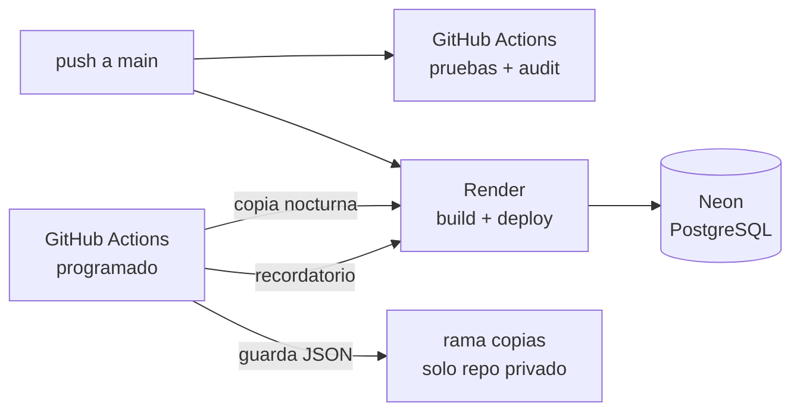

# Despliegue y operación

Infraestructura de coste cero: **Render** (servidor web), **Neon** (PostgreSQL) y **GitHub
Actions** (CI y tareas programadas).

> [!IMPORTANT]
> **La guía paso a paso para montar tu propia instalación está en
> [DESPLIEGUE-EN-RENDER.md](DESPLIEGUE-EN-RENDER.md).** Este documento describe la operación:
> variables, tareas programadas, recuperación y límites.

- [Primer despliegue](#primer-despliegue)
- [Variables y secretos](#variables-y-secretos)
- [Tareas programadas](#tareas-programadas)
- [Operación](#operación)
- [Recuperación ante fallos](#recuperación-ante-fallos)
- [Activar el código de casa](#activar-el-código-de-casa)
- [App de Android](#app-de-android)
- [Limitaciones del plan gratuito](#limitaciones-del-plan-gratuito)

---

## Primer despliegue

Resumen de [DESPLIEGUE-EN-RENDER.md](DESPLIEGUE-EN-RENDER.md):

1. **Copia** del repositorio con *Use this template* y nombres de la casa en `public/perfiles.js`.
2. **Base de datos.** Proyecto en [Neon](https://neon.tech) y su *pooled connection string*.
3. **Servidor.** En [Render](https://render.com), *New → Blueprint* sobre tu copia: lee
   [`render.yaml`](../render.yaml) y pide `DATABASE_URL` y `CODIGO_CASA`.
4. **Desplegar.** Las migraciones se aplican solas al arrancar.
5. **Comprobar** `https://<servicio>.onrender.com/api/health` → `{"ok":true,"db":true,"protegida":true}`.
6. **GitHub (opcional).** Variable `CASA_URL` y secreto `CODIGO_CASA` para activar las tareas
   programadas.

A partir de aquí, cada `push` a `main` despliega automáticamente.

## Variables y secretos

### Render

| Variable | Valor | Notas |
|---|---|---|
| `DATABASE_URL` | cadena de Neon | Obligatoria |
| `NODE_ENV` | `production` | |
| `TZ_FAMILIA` | `Europe/Madrid` | Define el cambio de día, semana y mes |
| `CODIGO_CASA` | `npm run codigo` | Muy recomendada en cualquier despliegue público; ver [más abajo](#activar-el-código-de-casa) |
| `VAPID_*` | — | Opcionales; si faltan, se generan y se guardan en `casa_meta` |
| `ANDROID_FINGERPRINT` | SHA-256 de Play Console | Solo si se publica en Google Play |

### GitHub (Settings → Secrets and variables → Actions)

| Nombre | Tipo | Uso |
|---|---|---|
| `CASA_URL` | variable | URL del servicio. **Sin ella, las tareas programadas no se ejecutan** |
| `CODIGO_CASA` | secreto | Copia nocturna y recordatorio, si el servidor tiene código |

## Tareas programadas

| Workflow | Horario (UTC) | Qué hace |
|---|---|---|
| `pruebas.yml` | cada push y PR | Pruebas de lógica, `npm audit` y batería HTTP contra PostgreSQL |
| `copia-diaria.yml` | `30 2 * * *` | Descarga `GET /api/backup` y lo guarda en la rama `copias` (`copias/AAAA-MM-DD.json` y `ultima.json`). Solo en repositorios privados: si el repositorio es público, falla a propósito |
| `recordatorios.yml` | 5 intentos entre 15:07 y 17:19 | `POST /api/push/recordatorios`; el servidor solo actúa en su ventana y una vez al día |
| `dependabot.yml` | npm semanal, Actions mensual | PR de actualización agrupadas (menores y parches) |

**Por qué cinco intentos.** GitHub retrasa las tareas programadas en horas de carga (se han
observado más de cuatro horas). El servidor descarta las llamadas fuera de 17:00–21:30 y registra
el envío de forma atómica, así que gana el primer intento puntual y el resto no hace nada.

Todas se pueden lanzar a mano desde *Actions → Run workflow*. El recordatorio lanzado a mano
ignora la ventana horaria (`FORZAR`), pero nunca envía dos veces el mismo día.

## Operación

| Tarea | Cómo |
|---|---|
| Ver si el servicio vive | `GET /api/health` |
| Ver dispositivos con avisos | Panel de padres → Avisos, o `GET /api/push/estado` |
| Simular el recordatorio | `POST /api/push/recordatorios?simular=1` |
| Descargar una copia | Panel de padres → Economía → Descargar, o `GET /api/backup` |
| Ver los registros | Render → Logs (prefijos `[state/put]`, `[push]`, `[copias/…]`) |
| Actualizar dependencias | Aceptar las PR de Dependabot con la CI en verde |

## Recuperación ante fallos

| Situación | Recuperación | Pérdida máxima |
|---|---|---|
| Reinicio o restauración por error | Panel de padres → Copias → copia *antes de…* → Volver a esta | ninguna |
| Datos corrompidos o borrados por un error de la app | Copia diaria más reciente | < 1 día |
| Pérdida de la base de datos | Nueva base de datos → desplegar → *Restaurar desde archivo* con `ultima.json` de la rama `copias` | < 1 día |
| Pérdida del servicio de Render | Nuevo Web Service con las mismas variables | ninguna |

Toda restauración guarda antes una copia del estado actual, así que también se puede deshacer.

## Activar el código de casa

Sin código, cualquiera que conozca la dirección puede leer y cambiar los datos. Para cerrarla:

1. `npm run codigo` → p. ej. `ABCD-EFGH-JKMN`.
2. Render → variable `CODIGO_CASA` → redeploy.
3. GitHub → secreto `CODIGO_CASA` con el mismo valor.
4. Cada dispositivo lo recibe una vez: por enlace (`https://<host>/#casa=CODIGO`, panel de
   padres → Economía → Acceso → Copiar enlace) o escribiéndolo cuando la app lo pide.

El fragmento `#casa=…` no se envía nunca al servidor, así que no queda en registros.

## App de Android

`casa-android/` contiene la configuración de una **Trusted Web Activity** (Bubblewrap): la misma
PWA empaquetada para Google Play. Compilación en
[`casa-android/COMPILAR.md`](../casa-android/COMPILAR.md) y publicación en
[`casa-android/GUIA-PLAY-STORE.md`](../casa-android/GUIA-PLAY-STORE.md).

## Limitaciones del plan gratuito

| Limitación | Impacto | Mitigación |
|---|---|---|
| Render suspende el servicio tras 15 min sin tráfico | Primera carga de hasta ~1 min | Ciclos perezosos; los workflows despiertan el servicio |
| Sin tareas programadas propias en Render | El servidor no puede despertarse solo | GitHub Actions como planificador |
| Retrasos de GitHub Actions | El recordatorio puede no enviarse un día | Cinco intentos y ventana horaria; alternativa: planificador externo o plan de pago |
