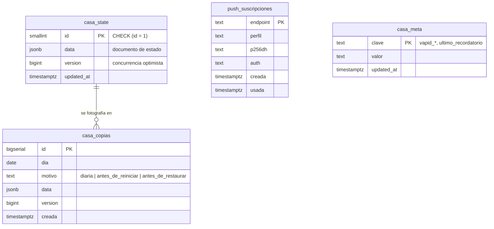
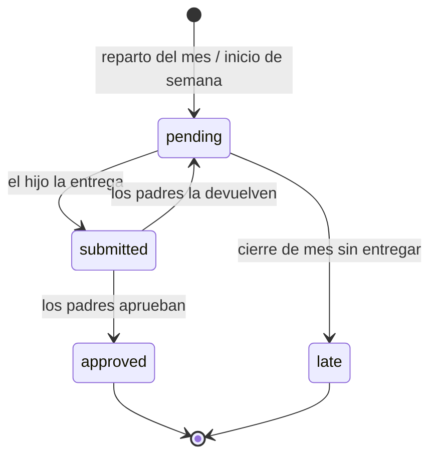

# Modelo de datos

El sistema guarda **un documento JSON por casa** más tres tablas auxiliares. La razón de este
diseño está en [ADR-0001](adr/0001-documento-unico-de-estado.md).

- [Tablas](#tablas)
- [El documento de estado](#el-documento-de-estado)
- [Entidades del documento](#entidades-del-documento)
- [Ciclo de vida de una tarea](#ciclo-de-vida-de-una-tarea)
- [Saneado y forma](#saneado-y-forma)
- [Migraciones](#migraciones)

---

## Tablas



| Tabla | Filas | Notas |
|---|---|---|
| `casa_state` | 1 | `CHECK (id = 1)` impide que aparezca una segunda casa por error |
| `casa_copias` | ≤ 40 | 30 diarias + 10 preventivas. Índice único parcial: una sola copia `diaria` por día, incluso con peticiones simultáneas |
| `push_suscripciones` | una por dispositivo | Se borra sola cuando el servicio de push responde `404` o `410` |
| `casa_meta` | pocas | Claves VAPID generadas y fecha del último recordatorio (garantía de una vez al día) |

Las suscripciones y las copias quedan **fuera** del documento: son de cada dispositivo o son
fotografías del documento, y viajar dentro de él las enviaría a todos los clientes en cada sondeo.

## El documento de estado

```jsonc
{
  // Ciclo actual (lo fija el servidor)
  "currentWeek": "2026-W44",
  "currentMonth": "2026-10",

  // Personas
  "members": [ { "id": "…", "name": "…", "role": "child|parent", "color": "#…", "load": "normal|reducida|minima" } ],

  // Economía
  "fixedPay": 8,          // € de paga fija semanal
  "rate": 0.05,           // € por punto de tarea adicional

  // Catálogos
  "fixedTasks": [ { "id": "f1", "name": "Hacer la cama", "icon": "🛏️", "freq": "daily|weekly" } ],
  "extraTasks": [ { "id": "e1", "name": "Limpiar el baño", "points": 40, "icon": "🛁" } ],

  // Progreso de la semana y reparto del mes
  "fixedState": { "<hijo>": { "f1": { "days": [true, false, …] }, "f4": { "status": "pending|submitted|approved|late" } } },
  "extras": [ { "id": "…", "taskId": "e1", "memberId": "<hijo>", "status": "…", "listed": false, "bounty": 0 } ],
  "generated": true,

  // Calculado por el servidor
  "streak": { "<hijo>": 4 },
  "streakCarry": { "<hijo>": 3 },
  "history": { "2026-09": { "points": { "<hijo>": 310 }, "hechas": { "<hijo>": 12 }, "vencidas": { "<hijo>": 1 } } },

  // Premios
  "rewards": [ { "id": "r1", "title": "1 h más de pantalla", "cost": 60, "type": "Tiempo", "stock": null, "active": true } ],
  "redemptions": [ { "id": "…", "rewardId": "r1", "childId": "<hijo>", "cost": 60, "status": "pending|approved|denied", "at": 0, "resolvedAt": 0 } ],

  // Mercado entre hermanos
  "listings": [ … ], "offers": [ … ], "marketLog": [ … ],

  // Menús
  "dishes": [ { "id": "d1", "name": "…", "type": "desayuno|comida|cena", "tags": [] } ],
  "menu": { "Lun": { "desayuno": "", "comida": "", "cena": "" }, … },

  // Calendario (plantilla semanal: no se reinicia)
  "horarios": { "<hijo>": [ { "id": "…", "label": "Colegio", "days": [0,1,2,3,4], "ini": "08:00", "fin": "14:30" } ] },
  "agenda": [
    { "kind": "fixed", "taskId": "f4", "childId": "<hijo>", "day": 5, "slot": "manana" },
    { "kind": "extra", "taskId": "e1", "day": 2, "slot": "tarde" }
  ]
}
```

`<hijo>` es el `id` estable de un perfil de hijo definido en `public/perfiles.js`.
`GET /api/state` añade `_version`, que no se guarda dentro del documento.

## Entidades del documento

| Campo | Propietario | Se reinicia | Descripción |
|---|---|---|---|
| `members` | sistema | nunca | Los perfiles fijos; solo `load` (disponibilidad) es editable |
| `fixedTasks`, `extraTasks` | padres | nunca | Catálogos |
| `fixedState` | hijo (lo suyo) / padres | cada lunes | Casillas de diarias (7 días) y estado de las semanales |
| `extras` | padres reparten / hijo entrega | cada mes | Asignación mensual de adicionales |
| `fixedPay`, `rate` | padres | nunca | Parámetros económicos |
| `streak`, `streakCarry` | **servidor** | — | Nadie puede escribirlos desde el cliente |
| `history` | **servidor** | — | Resumen archivado al cerrar cada mes |
| `rewards` | padres | nunca | Catálogo de premios con stock opcional |
| `redemptions` | hijo pide / padres resuelven | nunca | Peticiones de premio; los puntos quedan reservados mientras están pendientes |
| `listings`, `offers`, `marketLog` | hijos | cada mes | Ofertas, contraofertas y registro del mercado |
| `dishes`, `menu` | padres | nunca | Base de platos y semana de menús |
| `horarios` | padres | nunca | Bloques ocupados de cada hijo; las claves de todos los hijos están siempre presentes |
| `agenda` | padres | nunca | Plantilla semanal. Las adicionales no guardan hijo: se deduce del reparto del mes, así la entrada sobrevive al reparto y sigue a la tarea si cambia de dueño en el mercado |

## Ciclo de vida de una tarea



Las fijas diarias no tienen validación: cada casilla marcada cuenta directamente.

## Saneado y forma

- `sanitizeState()` (`services/stateGuard.js`) reconstruye el documento campo a campo con **lista
  blanca**: tipos, longitudes máximas, enumerados, ids existentes y referencias. Lo desconocido se
  descarta.
- `ensureFixedShape()`, `normalizarMenus()` y `normalizarCalendario()` completan la forma en el
  servidor y el resultado se persiste, para que el cliente nunca tenga que hacerlo.
- Las comparaciones de "¿ha cambiado?" usan `huella()`, independiente del orden de las claves,
  porque `jsonb` las reordena.

## Migraciones

`db/schema.js` aplica en orden los archivos `db/migrations/*.sql` al arrancar. Todos son
idempotentes (`CREATE … IF NOT EXISTS`, bloques `DO` condicionales).

| Migración | Contenido |
|---|---|
| 001–007 | Esquema de la primera versión, con cuentas y familias. Ya no se usa; se conserva intacto |
| 008 | `casa_state` y traslado del estado de la versión con cuentas |
| 009 | `casa_meta`, `push_suscripciones`, `casa_copias` |

Los ids de miembro de la versión con cuentas (UUID) se traducen a los ids de perfil en
`adoptarPerfiles()`, cubierto por `test/perfiles.test.js`.
